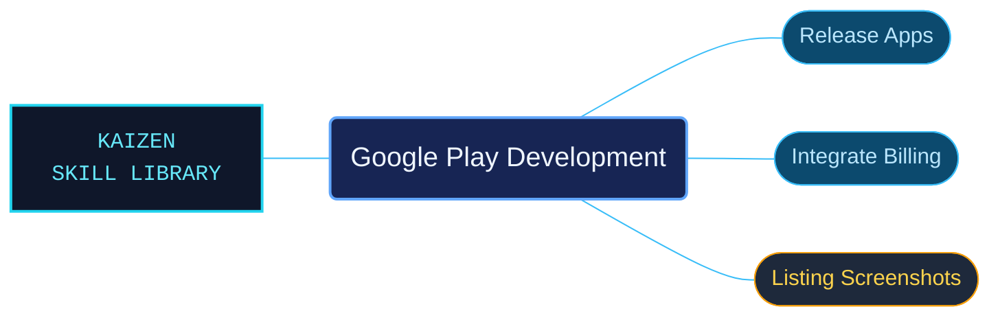

# Google Play Development

Prepare Google Play releases and integrate billing, integrity, delivery, review, update and Engage APIs using task-organized technical references. The screenshot tools support localized asset sets with approved copy, source-render evidence and separate batch and listing-count checks.

Use when developing or releasing Android apps through Google Play: app signing, Android App Bundles, Play Billing and subscriptions, alternative-payment programs, Play Integrity, asset and feature delivery, in-app reviews, updates and install prompts, Engage content integrations or Developer API automation; or preparing, localizing, validating or troubleshooting store listing screenshots and manifests for phones, tablets, desktop or Android XR. Not for general Android UI development, unrelated Google APIs or claiming Console acceptance from a saved screenshot preset.

| Task | Start here |
| --- | --- |
| Prepare signed releases and test app bundles | [Release preparation](references/release/index.md), [Android App Bundles](references/bundles/index.md) |
| Implement purchases, subscriptions and alternative-payment programs | [Play Billing](references/billing/index.md) |
| Verify integrity and handle remediation | [Play Integrity](references/integrity/index.md) |
| Deliver assets and feature modules | [Library selection and delivery](references/delivery/index.md) |
| Integrate review, update and install flows | [Reviews](references/in-app-reviews/index.md), [updates](references/in-app-updates/index.md), [install prompts](references/install-prompts/index.md) |
| Publish personalized content and TV entitlements | [Engage SDK](references/engage/index.md) |
| Select publishing, reporting and monetization automation | [Developer APIs](references/automation/index.md) |
| Choose categories and reconcile current Console requirements | [Screenshot requirements](references/screenshot-requirements.md) |
| Render sharp UI without enlarging existing bitmaps | [Source rendering and capture](references/source-rendering.md) |
| Preserve approved copy across languages and filenames | [Localized content](references/localized-content.md) |
| Record a complete view/language/category matrix | [Manifest contract](references/manifest-contract.md) |
| Run checks and diagnose failures | [Validation commands](references/validation-commands.md), [validation failures](references/validation-failures.md) |
| Review pixels and report evidence accurately | [Review and delivery](references/review-and-delivery.md) |

The tools inspect files; they do not render images or upload them. Python 3.10+ runs the CLI, and Pillow 10.4+ enables image checks and fixture tests. Use [the tool instructions](scripts/store-listing-screenshots/README.md) and [evaluation instructions](evals/EVALS.md) for execution details.

The `play-console-v1` preset retains its specified limits. Public XR guidance differs, so a preset pass cannot establish current Google acceptance. Read the requirements comparison before preparing a release set.

Technical references adapt and reorganize Android Developers documentation, preserve version-specific contracts and link complete long examples upstream. Use the live source for changing program eligibility, deadlines and rollout requirements. These references cover the bundled subjects; external API families and full Android platform documentation remain linked at their primary sources.

Java and OpenJDK are trademarks or registered trademarks of Oracle and/or its affiliates.

## Sources and license

Skill reference documentation is interpreted content for use in open source projects. Check against [official documentation sources](https://developer.android.com/google/play) when dealing with defects or issues that may come up from interpreting this skill's references.

Licensed under **Apache-2.0**; see [LICENSE](LICENSE). Part of the [Agent Kaizen](https://github.com/LevyBytes/agent-kaizen) skill library.
